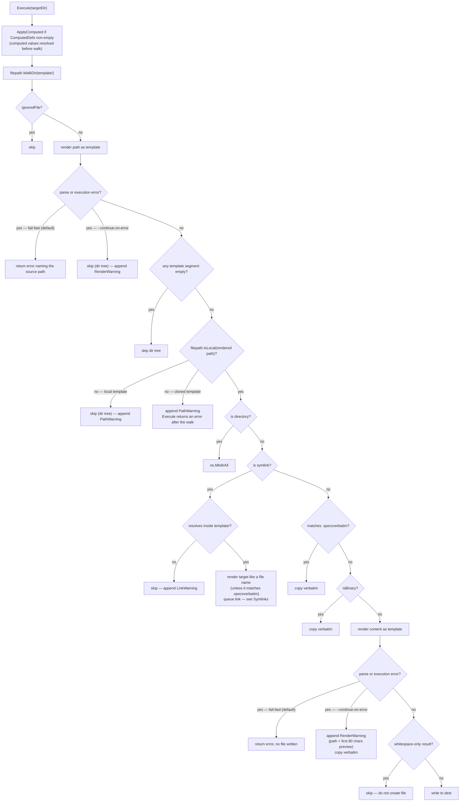

## Template Directory Convention

Every specs template is a directory with this structure:

```text
<template-root>/
├── project.yml          # variable schema with defaults
├── .specsverbatim        # verbatim-copy glob patterns (opt-out from rendering)
├── __metadata.json       # written by specs (name, repo, created)
└── template/             # the files that get rendered
    ├── {{ .Name }}.go    # {{ }} template syntax in filenames
    ├── README.md         # {{ }} template syntax in file contents
    └── src/
        └── {{ .Package }}/
            └── main.go
```

Only the `template/` subdirectory is ever rendered and written to the target.

---

## `project.yml` — Context Schema

Defines the variables that specs collects from the user (or uses as defaults).

```yaml
ProjectName: My Acme Project
ProjectShortName: acme-12

# Select — first value is the default
PhpVersion:
  - "8.5"
  - "8.4"
  - "8.3"

# Bool — false = no, true = yes
UseSonarQube: false

# Referenced default — shown as pre-fill, user can override
ProjectSlug: "{{ .ProjectShortName | toKebabCase }}"

# Computed — never prompted, always derived from final inputs
computed:
  DbName: "{{ .ProjectShortName | toSnakeCase }}_production"
  Year:   "{{ now | date \"2006\" }}"
```

| Value type               | Prompt behaviour                                             |
|--------------------------|--------------------------------------------------------------|
| `string`                 | Free-text input with default shown                           |
| `bool`                   | Yes/No confirm prompt                                        |
| `[]string`               | Select list; first item is default                           |
| `string` containing `{{` | Referenced default — pre-fill computed, user can override    |
| `computed:` section      | Never prompted — derived after all user inputs are finalised |

Every prompt is a huh group of its own, drawn by a custom layout (`promptLayout`) that fits as many
groups around the focused one as the terminal allows: the focused group, the one before it, the
groups after it, then earlier groups while lines are left. The layout reads the terminal height from
the `tea.WindowSizeMsg` through a program filter, so it adapts when the window is resized.

A single group holding every field is not used: huh fits a group taller than the terminal into a
scrolling viewport, but v2.0.3 draws that viewport one line taller than the terminal, and the
renderer cuts off whatever does not fit.

A group that is taller than the terminal on its own — a select with many options — is still fitted
by huh, into the full terminal height. The layout puts a blank line above the help, so after each
resize it shrinks every group by one more line. The filter never changes the `tea.WindowSizeMsg`
itself: the renderer sizes its frame from the message the filter returns, so a smaller height would
cut off every frame taller than that.

huh only ever shrinks a field to fit, and never grows it back. On every resize the filter resets each
field to its natural height before huh fits them again, so a select shrunk in a briefly short
terminal shows all its options once the terminal grows.

bubbletea must be v2.1.0 or later: earlier versions skip the redraw after a resize when the view
itself is unchanged.

The prompts are drawn on the alternate screen (`tea.View.AltScreen`, set through huh's view hook).
Drawn inline, below the shell prompt, a resize lets the terminal move lines between the screen and
its scrollback: shrinking pushes the top of the form into scrollback, growing pulls it back, and the
renderer, which only moves relative to its own frame, draws a fresh form below it. Every shrink and
grow left another copy of the top question behind. The alternate screen has no scrollback, and the
form erases itself on completion either way, so nothing that used to stay on screen is lost. The
remote-hook confirmation stays inline: it must stay below the hook commands printed just before it.

---

## Configurable Delimiters

Specs uses `{{ }}` by default — standard Go `text/template` syntax. To avoid conflicts with tools that also use `{{ }}` (e.g. GitHub Actions, Helm), you can override the delimiters per template using the reserved `__delimiters` key in `project.yml`:

```yaml
__delimiters:
  left: "[["
  right: "]]"
```

Both `left` and `right` must be non-empty strings. The `__delimiters` key is reserved: it is never treated as a user variable (never prompted for, never flagged as unused), but its value is available to templates for reading as `{{ .__delimiters }}` — see below.

### Reserved `__` namespace

The entire `__` prefix is reserved for specs configuration keys (such as `__delimiters`), so
that future configuration can be added without clashing with existing template variables.
A template may **not** define a user variable or a computed value whose name starts with `__`
unless it is a recognised configuration key. Any other `__`-prefixed name is rejected with
`ErrReservedVariableName` (`error_kind: reserved_variable_name`).

The check runs whenever a project file is loaded — during `template download`, `template use`
(and `specs use`), and `template validate` — so a template that misuses the namespace is
rejected at download time rather than only failing later at execution. Runtime overrides are
held to the same rule: a reserved name supplied via `--arg __foo=…` or a `--values` file is
also rejected.

```yaml
Name: my-project
__future: nope   # error: variable names starting with "__" are reserved
computed:
  __derived: "{{ .Name }}"   # error: computed names are reserved too
```

Reserved keys are held out of the schema context (`Template.Context`) so they are never prompted
for or reported as unused. Their raw values are captured separately in `Template.Reserved` and
merged into the render context in `Execute`, so templates can read them under their original key —
e.g. `{{ .__specs__version }}` or `{{ .__delimiters.left }}`. `Validate` also treats these keys
as defined, so referencing one is never flagged as an unknown variable.

With `[[ ]]` delimiters configured, `{{ }}` in your files passes through unchanged:

```yaml
# With __delimiters: left: "[[", right: "]]"

# ${{ }} passes through unchanged — no escaping needed
group: ${{ github.workflow }}-${{ github.ref }}
SONAR_TOKEN: ${{ secrets.SONAR_TOKEN }}

# Template expressions use [[ ]]
MARIADB_DATABASE: "[[ .ProjectShortName | toSnakeCase ]]_test"
```

---

## Version Gate (`__specs__version`)

Before loading a template's context, `template.Get()` runs a pre-flight check against the
reserved `__specs__version` key in `project.yml`. It lets a template author declare which
`specs` CLI versions the template supports:

```yaml
__specs__version: ^0.1.0
```

The value is any valid [Masterminds/semver](https://github.com/Masterminds/semver) constraint
string (`0.1.0`, `^0.1.0`, `~0.1.0`, `>= 0.1.0, < 2.0`, …), so both lower and upper bounds can
be expressed. `template.ExtractSpecsVersion` parses it with `semver.NewConstraint`; the private
`checkSpecsVersion` helper then evaluates it against the running CLI version (injected via
`Config.Version` from the cmd layer, so `pkg/template` never imports `pkg/cmd`):

| Condition                                                  | Outcome                                                               |
|------------------------------------------------------------|-----------------------------------------------------------------------|
| Key absent                                                 | No check — proceed                                                    |
| Present but not a string, or not a parseable constraint    | `ErrInvalidSpecsVersion` — refuse to load                             |
| `Config.Version` is empty, `dev`, or otherwise unparseable | Check skipped with a `slog.Debug` line — never lock out source builds |
| Parsed CLI version does not satisfy the constraint         | `ErrSpecsVersionUnsatisfied` (wrapped with `%w`)                      |
| Parsed CLI version satisfies the constraint                | Proceed                                                               |

The gate fires for both `specs use` and `specs template use` (which share `executeTemplate`).
`specs template save` never calls `Get()`, so a newer template can still be saved on an older
CLI. The reserved key is consumed during load and never exposed as a template variable.

---

## Always-ignored files

The following files are silently skipped during rendering, regardless of any other
configuration. They are OS/editor metadata that should never appear in scaffolded output:

| Filename    | Origin           |
|-------------|------------------|
| `.DS_Store` | macOS Finder     |
| `Thumbs.db` | Windows Explorer |

These files are skipped at the walk stage — they are never copied, rendered, or passed to
`.specsverbatim`. This list is fixed; use `.specsignore` if per-template suppression is
ever added in the future.

---

## `.specsverbatim` — Verbatim Copy

A `.specsverbatim` file at the template root lists glob patterns for files that should be
copied byte-for-byte without any template rendering:

```text
# .specsverbatim
composer.lock
package-lock.json
*.min.js
vendor/**
```

---

## Conditional Files and Directories

Use the filename itself as a template expression. `Execute` renders the whole template-relative
path as one template, with the template's own separators swapped for a marker, and splits the
result back into one segment per file or directory name. If any of those names renders empty or
whitespace-only, the file is skipped, and a directory is skipped with its subtree. This is what
makes conditional directory trees work.

```text
template/
├── {{ if .UseSonarQube }}sonar-project.properties{{ end }}
└── {{ if .UseSonarQube }}docs{{ end }}/
    └── images/
        └── badge.png
```

| `UseSonarQube`      | Rendered segments                | Result                  |
|---------------------|----------------------------------|-------------------------|
| `true`              | `sonar-project.properties`       | created                 |
| `false`             | *(empty)*                        | skipped                 |
| `true` (badge.png)  | `docs`, `images`, `badge.png`    | `docs/images/badge.png` |
| `false` (badge.png) | *(empty)*, `images`, `badge.png` | skipped — empty segment |

Each name is rendered in the context of its own path, so an action cannot span directories: a
directory named `{{ if .X }}docs` does not parse on its own, which is a render error.

Names render with `missingkey=error`, like file contents. A name that fails to render (a parse
error, an undefined variable, an execution error) is never mistaken for a conditional: it aborts
`Execute`, naming the source path under `template/`. With `--continue-on-error` it becomes a
`RenderWarning` with `Skipped` set, and the file, or the directory with its subtree, is not
written. Unlike file contents, a name has no verbatim fallback. Only a name that renders empty or
whitespace-only is skipped silently.

A separator inside a rendered segment comes from a value, not from the template: with `Dir: a/b`,
`{{ .Dir }}/x.txt` is written as `a/b/x.txt`. A value that empties a segment the same way a
conditional does (`Dir: " "`) is skipped the same way, but a value that adds an empty segment
(`Dir: a//b`) does not: the path is cleaned and written as `a/b/x.txt`.

---

## Render Pipeline



### Rendered paths

The boundary is the output directory: every rendered path must stay inside it. After the
empty-segment check, `Execute` joins the rendered segments and requires
`filepath.IsLocal(rendered path)`. That rejects `..` segments that climb out of the output,
absolute paths and, on Windows, volume and reserved names. A `..` that stays inside is kept:
`a/../b/x.txt` is written as `b/x.txt`.

Only the template's own segments count for the empty-segment check, so an absolute value
(`Dir: /tmp/x`) is not mistaken for a conditional and reaches this check.

A path that fails the check is recorded in `Template.PathWarnings` as a `*template.PathError`
(source path under `template/`, rendered path, `specs.ErrPathOutside`). A directory is skipped
together with its subtree. What happens next depends on where the template came from:

| Template                                                              | Result                                                                                                                          |
|-----------------------------------------------------------------------|---------------------------------------------------------------------------------------------------------------------------------|
| Local (`specs use <path>`, `template save`)                           | Skipped; `template use` reports each one with `Output.Warn`                                                                     |
| Cloned (`specs use <git-url>`, or a registry entry with a remote URL) | `Execute` returns every `PathError` joined after the walk; the render temp dir is discarded and nothing is copied to the target |

`Config.RejectEscapingPaths` selects the cloned behaviour. `executeTemplate` sets it for
`specs use <git-url>` and for every registered template whose `__metadata.json` records a remote
`Repository` (`Metadata.IsRemote`), so `template download` followed by `template use` is covered.
A cloned template's file names, and the defaults they render with, were written by someone else.

The check is on the rendered result, so it applies whatever supplied the value: a schema default,
`--arg`, `--values` or a prompt answer.

### Render error modes

| Mode                    | Behaviour                                                                                                                                                                                                                                                                 | How to enable              |
|-------------------------|---------------------------------------------------------------------------------------------------------------------------------------------------------------------------------------------------------------------------------------------------------------------------|----------------------------|
| **Fail-fast** (default) | Parse or execution errors, in a file's content or in a file or directory name, abort `Execute` immediately; no destination file is written for the affected path. The tmp dir is cleaned up by the deferred `os.RemoveAll` in `template use`.                             | Default — no flag needed   |
| **Continue-on-error**   | Parse or execution errors are recorded as `RenderWarning` entries. A file whose content failed is copied verbatim; a file or directory whose name failed is skipped (`Skipped` is set). Restores the pre-v0.x behaviour. Use only when `.specsverbatim` is not an option. | `--continue-on-error` flag |

If any `RenderWarning` entries are present after `Execute` returns (only possible with `--continue-on-error`):

- **`template use`** reports each affected file via `Output.Warn`, including the destination
  path and the first 80 characters of the unrendered source so the user can grep for
  straggling `{{ }}` literals. A skipped name is reported with its source path under `template/`
  instead. It also suggests running `specs template validate <name>`.
- **`template validate`** reports each affected file, includes them in the exit code
  (`ValidateRender = 4`), and always runs at debug log level so no diagnostic output
  is suppressed.

### Binary Detection

The engine inspects the first 512 bytes of every file using a two-stage check. Binary files
are copied byte-for-byte; no template rendering is attempted.

**Detection order:**

1. **`http.DetectContentType`** — identifies known binary formats by magic bytes (JPEG, PNG,
   PDF, ZIP, gzip, and others). If the detected content type is not a `text/*` type, the
   file is treated as binary.
2. **Null-byte / invalid-UTF-8 fallback** — if `DetectContentType` returns `text/plain`,
   the file is still treated as binary when the first 512 bytes contain a null byte or are
   not valid UTF-8. This catches edge cases such as UTF-16 LE files (which have many null
   bytes) or binary payloads whose prefix happens to look like text.

**Limitations and `.specsverbatim`:**
Binary detection is best-effort. Any file that must be copied verbatim should be listed
explicitly in `.specsverbatim` rather than relying on auto-detection:

```text
# .specsverbatim — recommended patterns for common binary assets
*.png
*.jpg
*.ico
*.woff
*.woff2
*.ttf
*.pdf
*.gz
*.tar
*.zip
```

### File Permissions

Source file permission bits (mode) are always preserved in the destination, regardless of
the copy strategy:

- **Binary / verbatim copy** (`copyFile`): the source `os.Stat` mode is applied to the
  destination via `os.OpenFile(..., info.Mode())` followed by `os.Chmod`.
- **Rendered text** (`writeFile`): `renderFile` stats the source before rendering and
  passes `info.Mode()` to `writeFile`, which applies it with `os.WriteFile` + `os.Chmod`.

The same preservation applies when a template is saved to the local registry
(`specs template save` / `specs use <local-path>`): `osutil.CopyDir` uses the same
`os.Stat` + `os.Chmod` pattern, so a script that is `chmod +x` in the source stays
executable in the registry and in every scaffolded output.

### Symlinks

A symlink is never read through. The boundary is the template's `template/` directory: a link
is valid only when it resolves to something the template itself ships.

`osutil.ResolveLink(root, path)` decides this. It follows the link one path component at a time,
the way the OS does, instead of cleaning the path lexically. With `a → ..`, the OS resolves
`a/../x` to `../../x`, but lexical cleaning turns it into `x`. Lexical cleaning would accept that
link even though it escapes. The result is one of three:

| Result        | When                                                                                              | Sentinel                   |
|---------------|---------------------------------------------------------------------------------------------------|----------------------------|
| In bounds     | The whole chain stays inside the root and ends at a file or directory                             | —                          |
| Out of bounds | The target is absolute, or any step of the chain leaves the root, even if a later step comes back | `specs.ErrSymlinkOutside`  |
| Dangling      | The chain ends at nothing, runs through a file, or loops (more than 40 hops)                      | `specs.ErrSymlinkDangling` |

Absolute targets are always out of bounds. Such a link stops pointing into the template as soon as
the template is copied, for example into the registry.

**`Execute`** handles each symlink under `template/` as follows:

1. Its name is rendered like any other path, so conditionals and empty segments skip it the same way.
2. A link that is out of bounds or dangling **in the source** is skipped and recorded in
   `Template.LinkWarnings` as an `*osutil.LinkError` (path, target as written, sentinel).
3. An in-bounds link's target is rendered like a file name, so `.node-version → {{ .Name }}.rc` points
   at the rendered name. A link matching `.specsverbatim` keeps its target as written. A render error
   in the target fails fast, or becomes a `RenderWarning` with `--continue-on-error`.
4. After the walk, every link is created with its rendered target and checked against the
   **output**. A link whose target was not written (removed by a conditional, rendered empty,
   whitespace-only content) or that now leaves the output is removed and recorded in
   `LinkWarnings` with the reason `in the generated project`. Links are created only after the
   walk, so a target written after its link is still found.
5. A link that cannot be created is skipped and recorded the same way. On Windows this covers
   missing privileges. The target is never copied in its place.

Directory links are recreated, not descended into. `AnalyzeConditionals` and `Validate` analyse a
link's target as a path expression and never read its content.

**`osutil.CopyDir`** recreates every symlink that resolves inside the copied tree with the same
target, and skips the rest, returning them as `[]*osutil.LinkError`. Without this, the
temp → target copy in `template use` would flatten the links `Execute` created. For a local
template, the first copy (`specs use <path>`, `template save`, local upgrade) would read outside
files before `Execute` ever runs. Its bound is the copied root, not `template/`. A link from
`template/` to `../project.yaml` survives the copy and is then skipped by `Execute`. Every caller
reports the skipped links with `Output.Warn`. A local upgrade passes them back in
`UpgradeResult.SkippedLinks`.

**Cloned templates are rejected, not trimmed.** `template.CheckLinks(templateRoot)` returns an error
naming every out-of-bounds link under `template/` (dangling links pass; `Execute` skips them). It
runs wherever a template is cloned, so `template download` followed by `template use` cannot
bypass it:

| Clone site            | On rejection                                                                                                                 |
|-----------------------|------------------------------------------------------------------------------------------------------------------------------|
| `specs use <git-url>` | Aborts before `Get`; the clone lives in a temp dir, nothing is written to the target                                         |
| `template download`   | Removes the fresh clone, so the template is not registered                                                                   |
| `template upgrade`    | The clone is staged under the config dir and only swapped in after the check passes, so the registered template is untouched |

---

## Template Functions

All of Go's standard `text/template` built-ins are available, plus:

### Custom Functions (`internal/template/specsregistry.go`)

| Function         | Signature                                                         | Description                             |
|------------------|-------------------------------------------------------------------|-----------------------------------------|
| `hostname`       | `() string`                                                       | System hostname                         |
| `username`       | `() string`                                                       | Current OS username (env/UID fallbacks) |
| `toBinary`       | `(n int) string`                                                  | Format integer as binary string         |
| `formatFilesize` | `(bytes float64) string`                                          | Human-readable size (KB/MB/GB…)         |
| `password`       | `(length, digits, symbols int, noUpper, allowRepeat bool) string` | Secure random password                  |

### Sprout Functions

All functions from [`go-sprout/sprout`](https://github.com/go-sprout/sprout) are available —
~100 helpers for string manipulation, math, date/time, encoding, and more.

Key renamed functions vs the old sprig library:

| Old (sprig)         | New (sprout)                    |
|---------------------|---------------------------------|
| `kebabcase`         | `toKebabCase`                   |
| `snakecase`         | `toSnakeCase`                   |
| `camelcase`         | `toPascalCase`                  |
| `upper`             | `toUpper`                       |
| `lower`             | `toLower`                       |
| `title`             | `toTitleCase`                   |
| `b64enc` / `b64dec` | `base64Encode` / `base64Decode` |

### Template Options

```go
tmpl.Option("missingkey=error")
```

Any variable referenced in a template that has no value in the context causes an error,
preventing silent empty substitutions.

### Safe Mode

When `--safe-mode` is set (or for untrusted template sources), the `env` and `filesystem`
Sprout registries are disabled — templates cannot read host environment variables or access
the filesystem beyond their own template directory.

---

## Iterative Conditional Prompting

Before prompting, specs analyses the template file tree's AST to determine which variables
are guarded behind conditions (see `internal/template/analysis.go`). Prompting is iterative:

1. **Pass 1** — unconditional variables (always needed, regardless of any condition)
2. **Pass 2+** — each round finds conditional variables whose guard variables are all resolved,
   evaluates the condition against the current context, and prompts those that are needed.
   This repeats until no more conditional variables can be resolved.

Variables that appear nowhere in the template files or computed expressions are skipped
entirely — they are never prompted regardless of their presence in `project.yml`.

The condition types recognised by the AST analyser are:

| Template expression        | Condition type             |
|----------------------------|----------------------------|
| `{{ if .Var }}`            | `condField` — truthy check |
| `{{ if not .Var }}`        | `condNot` — negation       |
| `{{ if eq .Var "value" }}` | `condEq` — equality        |
| `{{ if ne .Var "value" }}` | `condNe` — inequality      |
| `{{ if and .A .B }}`       | `condAnd` — conjunction    |
| `{{ if or .A .B }}`        | `condOr` — disjunction     |

Unrecognised condition forms fall back to treating the variable as always-needed
(conservative: over-prompt rather than under-prompt).

### When a prompt cannot be answered

Each pass first asks whether it is allowed to prompt at all. `App.canPrompt` says no when
`--non-interactive` is set, and otherwise when `output.IsTTY(App.Stdin)` reports that stdin is not
a terminal. The check is on **stdin** rather than on an output stream because the failure being
prevented is a read with nobody to answer it: a job with a terminal on stderr and its stdin closed
must still refuse.

A pass that has fields to draw and no way to draw them returns `specs.ErrCannotPrompt`, naming
every key it would have asked for and how to supply them. That turns a silent hang — a CI job
blocking until the runner's timeout kills it, with nothing in the log explaining why — into an
immediate, actionable failure.

The form is drawn through `App.Stdin` and `App.Stderr`, populated in `PersistentPreRunE` from
`cmd.InOrStdin()` and `cmd.ErrOrStderr()`. Never stdout: a prompt is narration, and its redraws
would corrupt `--output json` and land in whatever file a caller redirected stdout to. Those seams
are also what let a test drive a form through buffers it controls.

---

## Hooks

Hooks run shell commands before and after `specs template use`. Two trigger points:

| Hook       | Working directory         | Runs                                                                                  |
|------------|---------------------------|---------------------------------------------------------------------------------------|
| `pre-use`  | template source directory | Before any files are rendered. Non-zero exit aborts.                                  |
| `post-use` | target (output) directory | After all files are written. Receives resolved context as `SPECS_`-prefixed env vars. |

Two mutually exclusive definition forms:

**Form A — inline in `project.yml`:**

```yaml
hooks:
  pre-use:
    - echo "Scaffolding {{ .ProjectName }}..."
  post-use:
    - composer install
    - npm install
    - |
      git init
      git add -A
      git commit -m "Initial commit: {{ .ProjectName }}"
```

**Form B — script files:**

```text
template-root/
├── project.yml
├── hooks/
│   ├── pre-use.sh
│   └── post-use.sh
└── template/
```

Context values are injected as `SPECS_`-prefixed uppercase env vars:
`ProjectName` → `SPECS_PROJECTNAME`.
The prefix can be disabled with the root `--no-env-prefix` flag.

### Trust model

Hooks run arbitrary shell commands on the host. Before running any template with hooks:

| Scenario                            | Behaviour                                                                             |
|-------------------------------------|---------------------------------------------------------------------------------------|
| `--safe-mode` (no `--allow-hooks`)  | Hooks are **skipped entirely** — no bash invocation                                   |
| `--safe-mode --allow-hooks`         | Function-level restrictions apply; hooks **run** (remote confirmation still required) |
| `specs use <remote>` with hooks     | Rendered hook commands are **printed** and **interactive confirmation** is required   |
| `specs use <remote> --yes`          | Confirmation prompt is skipped; hooks run (CI use)                                    |
| `specs use <remote> --no-hooks`     | Hooks are **skipped**                                                                 |
| `specs use <remote>`, no terminal   | Nothing can confirm, so the answer is **no**: hooks are skipped with a warning        |
| Local template or registry template | No confirmation prompt; hooks run as normal                                           |

**`--safe-mode` implies `--no-hooks`** in the command layer. Pass `--allow-hooks` alongside `--safe-mode` to disable only the env/filesystem template functions while still allowing hooks to execute.

When running a remote template interactively (`specs use user/repo ./out`), specs prints all pre-use and post-use hook commands (rendered against the resolved context) and asks for confirmation before executing any of them. Passing `--yes` suppresses this prompt for scripted or CI use.

Unlike a missing variable, an unanswerable hook confirmation is **not** an error. Declining is the
safe reading of a question nobody can answer, so the template is still applied and only its hooks
are skipped — failing instead would break every CI job using a remote template that happens to
define one. The warning names `--yes` as the way to opt in.

If `bash` is not on `PATH`, hook execution returns an actionable error identifying the missing shell rather than a confusing process-not-found failure.

---

## Metadata (`template.Metadata`)

```go
type Metadata struct {
    Name       string   `json:"Name"`
    Repository string   `json:"Repository"`
    Branch     string   `json:"Branch,omitempty"`
    Created    JSONTime `json:"Created"`            // set on first install; preserved across upgrades
    Updated    JSONTime `json:"Updated"`            // set on first install; refreshed on each upgrade
    Commit     string   `json:"Commit,omitempty"`   // full SHA-1 of HEAD at download/upgrade
    Version    string   `json:"Version,omitempty"`  // git-describe-style version string
}
```

`Created` records when the template was first added to the registry (via
`template download` or `template save`) and is intentionally preserved across
`template upgrade` so the `list` command's `Created` column reflects the
original install time, not the most recent upgrade.

`Updated` records the last time the template was upgraded (via `template
upgrade`). On first install it is set to the same timestamp as `Created`, and it
is refreshed to the current time on each successful upgrade. The `list` command's
`Updated` column reflects this value. Metadata written before the `Updated` field
existed has no `Updated` key; `LoadMetadata` falls back to `Created` in that case
so pre-existing templates still display a sensible value.

`Commit` and `Version` change on upgrade (alongside `Updated`); `Created` never
does.

`JSONTime` wraps `time.Time` with RFC1123Z serialisation and a human-readable `"X time ago"`
display format for the `list` command.

---

## Validation (`specs template validate`)

`specs template validate` always runs at debug log level so no diagnostic output is suppressed.
It calls `Execute` on a temporary directory first to catch render errors, then calls
`Template.Validate()` for static analysis.

These issues are reported:

| Issue kind         | Source       | Meaning                                                                                |
|--------------------|--------------|----------------------------------------------------------------------------------------|
| `render_error`     | `Execute()`  | A file's content (copied verbatim) or a name (skipped) failed to render.               |
| `symlink`          | `Execute()`  | A symlink was skipped: out of bounds, dangling, or not creatable (see Symlinks).       |
| `path_outside`     | `Execute()`  | A rendered path, with the schema defaults, is outside the output (see Rendered paths). |
| `unknown_variable` | `Validate()` | A name used in a template file or path is **not defined** in `project.yaml`.           |
| `unused_variable`  | `Validate()` | A variable **defined** in the user input section is never referenced anywhere.         |
| `unused_computed`  | `Validate()` | A computed value **defined** under `computed:` is never referenced anywhere.           |

Exit codes are a bitmask — multiple conditions combine additively:

| Bit | Constant          | Value | Condition                                                                 |
|-----|-------------------|-------|---------------------------------------------------------------------------|
| 4   | `ValidatePaths`   | 16    | Any rendered path outside the output                                      |
| 3   | `ValidateLinks`   | 8     | Any skipped symlink                                                       |
| 2   | `ValidateRender`  | 4     | Any `render_error` — parse or execution error in a file's content or name |
| 1   | `ValidateUnknown` | 2     | Any `unknown_variable`                                                    |
| 0   | `ValidateUnused`  | 1     | Any `unused_*` (only with `--strict`)                                     |

`specs template validate` exits 0 only when there are no render errors, no skipped symlinks, no
rendered paths outside the output and no unknown variables.

---

## Template Status Tracking

`__status.json` caches the result of a status check per template. The `list` command
refreshes entries that need it concurrently, bounded to at most 8 parallel checks via
`errgroup.SetLimit(8)`. Each individual remote check has a 10-second per-remote timeout;
the entire refresh phase has a 30-second top-level timeout. Both timeouts use `context.Context`
propagated from the command, so Ctrl-C cancels in-flight checks immediately.
The `update` command forces an immediate refresh for one or all templates.

```go
type TemplateStatus struct {
    CheckedAt     JSONTime              // time of last check
    IsUpToDate    bool                  // true when no newer version is available (see below)
    LatestVersion string                // set when a newer version is available
    ErrorKind     pkggit.CheckErrorKind // "network", "auth", "not-found", "source-missing", "unknown", or ""
    SpecsVersion  string                // specs CLI version that wrote this status
}
```

`specs template list` displays a `Status` column with labels: `up-to-date`,
`update: <version>`, `update available`, `unknown (offline?)`, `auth error`, `not found`,
`source missing`.

### When a cached status is refreshed

`TemplateStatus.NeedsRefresh(currentVersion)` decides whether the `list` command re-checks a
cached status. A refresh happens when either:

- the status is **stale** — older than 24 hours (`IsStale`); or
- the status was written by a **different specs version** — `SpecsVersion` does not match the
  running binary.

The version guard ensures a status produced by an older binary with different check logic is
never trusted after an upgrade: a status-detection fix takes effect on the first `list` after
the upgrade instead of waiting out the 24-hour window. `SpecsVersion` is stamped on every
status written by `list` and `update`.

### Remote vs local templates

The source of truth depends on how the template was registered:

- **Remote templates** (`Repository` is a git URL) are checked against the remote via
  `CheckRemoteContext`, which lists the remote refs without modifying the local checkout.
- **Local templates** (`Repository` is a path, from `specs template save`) are checked
  against the **source directory on disk** via `CheckLocalSource` — never a git remote. The
  template is behind when the source path's current `git describe` (commit + version) differs
  from the commit/version recorded in metadata at save time. The trailing `-dirty` marker is
  ignored while the source stays on the saved commit: an uncommitted (dirty) working tree flips
  that suffix on the git-describe version even though `HEAD` has not moved, so comparing it
  verbatim would report a phantom update to the same commit (issue #97). When the source path no
  longer exists (or is no longer a git repository) the status is `source-missing`. A local
  template saved from a non-git directory has no recorded commit and is not tracked.

A path is told from a git URL by its first character — `/`, `.` or `~` — via
`template.IsLocalRepository`. `$HOME` is stored as `~`, so the value reads the same as the label
`template list` shows; `template.LocalSourcePath` expands it back before anything touches the
filesystem, and every caller that does must go through it.

Older versions wrote a `local:` prefix instead. It is still recognised on read, indefinitely: a
template nobody upgrades keeps it forever. An upgrade is the one moment the metadata is rewritten
anyway, so that is where a legacy value migrates to the current form.

### How a newer version is determined (remote templates)

`resolveStatus` compares the remote refs against the local checkout using two modes:

- **Tag-tracked** — the tracked ref is itself a semver tag (e.g. the template was downloaded
  with `owner/repo:1.1.0`). A newer version is the **highest semver tag strictly
  greater** than the current one. A lower-numbered tag published later (e.g. `1.0.1` after
  `1.1.0`) is never treated as an update.
- **Branch-tracked** — the tracked ref is a branch (the default when no ref is given). If the
  local checkout sits exactly on a released semver tag, the same semver rule as above applies:
  an update requires a strictly-greater semver tag, so `1.0.1` pushed on a commit newer than
  the installed `1.1.0` is **not** reported as an update. When the checkout is not on a semver
  tag (a rolling branch), the check falls back to comparing the branch-tip commit against the
  local `HEAD`, so any new commit counts as an update.

This ensures "newer" always follows semantic-versioning rules for tagged templates, regardless
of the order in which tags were pushed (issue #83). Determining whether the checkout is on a
released version uses the tag that points exactly at `HEAD` (dereferencing annotated tags)
rather than parsing git-describe output, whose `-<n>-g<hash>` suffix would otherwise be
misread as a semver pre-release.
